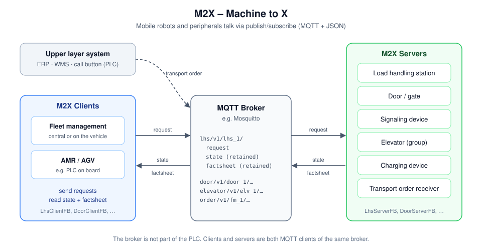
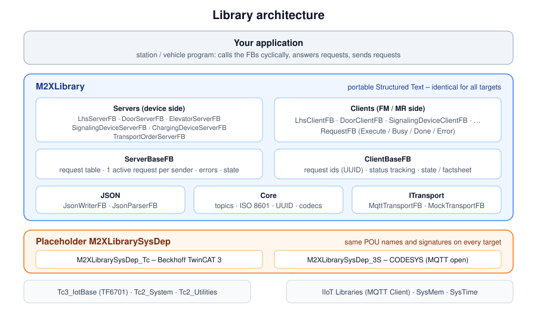

# M2X PLC Library

**Open IEC 61131-3 implementation of the M2X interface – client and server – for TwinCAT 3 and CODESYS.**

M2X ("Machine to X") standardises the communication between mobile robots / fleet management and their environment: load handling stations, doors, elevators, signaling devices, chargers and transport order systems. This library brings M2X directly into the PLC – as the **device side (server)**, e.g. a conveyor station or a door, and as the **robot side (client)**, e.g. a self-built AMR with a PLC on board.



## Features

- **Server and client for all six M2X interfaces** – load handling station, door, signaling device, elevator, charging device, transport order
- **MQTT + JSON** as recommended by M2X, via the MQTT client of the target (TwinCAT: TF6701 `Tc3_IotBase`, CODESYS: IIoT Libraries – not bound yet)
- **Complete request handling** in the library: request lifecycle, "one active request per participant", sequence checks, PENDING queue, `requestCancel`, `requestFactsheet`
- **State publishing** on every change and every 30 s, **last will** `CONNECTION_BROKEN`, `OFFLINE` on disable
- **JSON writer and parser in pure Structured Text** – no additional license, same behaviour on every PLC
- **Neutralisation layer** (`M2XLibrarySysDep`): one portable main library, one small system dependent library per target
- **Mock broker** for tests without network, **43 TcUnit tests** including a real MQTT loopback



## Status

Based on the **M2X specification 0.9.0 (June 2026)**. The specification is work in progress, so breaking changes are expected until M2X 1.0.

| Interface | Server | Client | Tests |
|---|:---:|:---:|:---:|
| Load handling station (`lhs`) | ✔ | ✔ | 9 + MQTT |
| Door (`door`) | ✔ | ✔ | 3 |
| Signaling device (`signal_light`) | ✔ | ✔ | 3 |
| Elevator (`elevator`) | ✔ | ✔ | 3 |
| Charging device (`charging_device`) | ✔ | ✔ | 2 |
| Transport order (`order`) | ✔ | ✔ | 4 |

| Target | Status |
|---|---|
| Beckhoff TwinCAT 3.1.4024 or newer (XAE Shell or Visual Studio) | ✔ tested with 3.1.4026 (local runtime, Mosquitto) |
| CODESYS 3.5 (ctrlX PLC Engineering) | `M2XLibrarySysDep_3S` available (memory, time, LREAL check); **MQTT client not bound yet**, main library not tested on CODESYS yet |

## Quick start

A load handling station as M2X server:

```iecst
fbStation(Enable := TRUE, Transport := fbMqtt);   // 1. M2X server
fbMqtt(Enable := TRUE);                           // 2. MQTT transport

IF fbStation.GetNextRequest(Request := stRequest) > 0
THEN
  // stRequest.RequestType = REQUEST_ACCESS, REQUEST_LOAD_TRANSFER, …
  // … do the work, then:
  fbStation.SetRequestStatus(RequestId := stRequest.RequestId, Status := RequestStatusEnum.FINISHED, ResultDescription := '');
END_IF
```

An AMR as M2X client of this station:

```iecst
fbStation(Enable := TRUE, Transport := fbMqtt);
fbMqtt(Enable := TRUE);

sRequestId := fbStation.RequestAccess(LoadHandlingSessionId    := 'S-0815',
                                      LoadHandlingPointId      := 'LHP1',
                                      VehicleType              := 'AMR',
                                      LoadAction               := LoadActionEnum.PICK,
                                      ActiveLoadTransferDevice := LoadTransferDeviceEnum.LHS);
// later: fbStation.GetRequestStatus(RequestId := sRequestId) = RequestStatusEnum.FINISHED → drive in
```

The complete examples are in the [usage guide](docs/Usage.md).

## Documentation

| Document | Content |
|---|---|
| [M2X explained](docs/M2X.md) | what M2X is, how it works, all requests (commands) and states (events), errors, decisions of this library |
| [Usage guide](docs/Usage.md) | setup, server and client examples, all interfaces, configuration, diagnosis, tests, troubleshooting |
| [Changelog](CHANGELOG.md) | versions (semantic versioning) |

## Software delivery

The libraries are delivered as **not compiled libraries** (visible source code) and in addition as **PLCopen XML**, which can be imported into other PLC IDEs:

| File | Content |
|---|---|
| `M2XLibrary.library` / `.xml` | the portable main library (library / PLCopen XML) |
| `M2XLibrarySysDep_Tc.library` / `.xml` | system dependencies for Beckhoff TwinCAT 3 |
| `M2XLibrarySysDep_3S.library` / `.xml` | system dependencies for CODESYS |
| `M2XLibrary.libcat.xml` | library category "M2X" (TwinCAT) |

Both system dependent libraries are installed under the same name **`M2XLibrarySysDep`** – the main library references it, the target decides which one is installed. Installation: see the [usage guide](docs/Usage.md#2-setup).

## Repository structure

```
├─ README.md · CHANGELOG.md · LICENSE
├─ docs/                          M2X explained, usage guide, diagrams
├─ *.library · *.xml              libraries and PLCopen XML (see above)
├─ M2XLibrary/M2XLibrary/         main library
│  ├─ Server/  Client/            interface FBs
│  ├─ Json/  Core/                JSON writer/parser, UUID
│  ├─ Transport/                  MQTT and mock transport
│  ├─ Functions/                  codecs, enum conversion, helpers
│  └─ Structures/  Enumerations/  Interfaces/  Parameter/  Constants/
├─ M2XLibrarySysDep_Tc/           TwinCAT system dependencies
├─ M2XLibrarySysDep_3S/           CODESYS system dependencies
└─ M2XLibraryTest/                TcUnit tests
```

## Requirements

| | TwinCAT | CODESYS |
|---|---|---|
| PLC | TwinCAT 3.1.4024 or newer (XAE Shell or Visual Studio) | CODESYS 3.5 SP20 (tested with ctrlX PLC Engineering 3.6) |
| MQTT client | TF6701 IoT Communication (`Tc3_IotBase`) – trial license for testing | CODESYS IIoT Libraries SL (MQTT Client SL) – not bound yet |
| MQTT broker | e.g. Mosquitto | e.g. Mosquitto |
| Tests | TcUnit 1.3 | – (test project only for TwinCAT so far) |

## Roadmap

- MQTT client in `M2XLibrarySysDep_3S` (CODESYS IIoT Libraries) and tests of the main library on CODESYS
- release workflow
- factsheet data types and generator from the M2X JSON schemas
- OPC UA transport
- update to the next M2X release (1.0 RFC)

## License and legal notice

This library is an independent IEC 61131-3 implementation of the M2X interface specification.

The library's original source code is licensed under the MIT License.

The M2X specification is published by the M2X Project ([github.com/M2X-Project/m2x](https://github.com/M2X-Project/m2x)) under the Apache License, Version 2.0.

This project is not officially affiliated with or endorsed by the M2X Project.

## Disclaimer

M2X is not a safety protocol: safety functions (muting, light curtains, protective doors) remain in the safety controller.

This project is provided without any guarantee and can be used for private and commercial purposes. Any use is at the user's own risk and responsibility.
