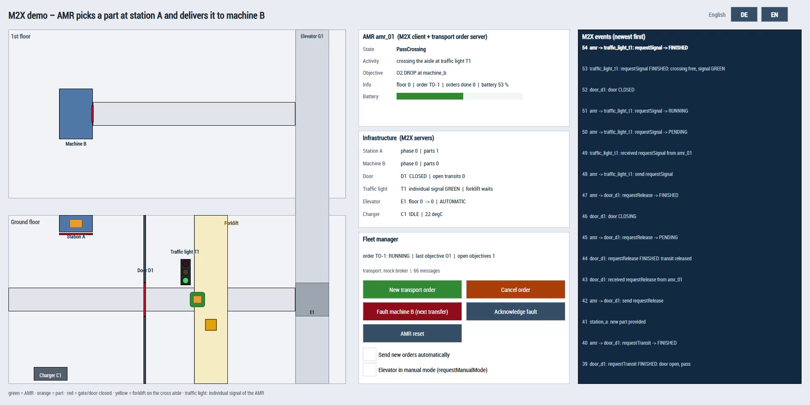
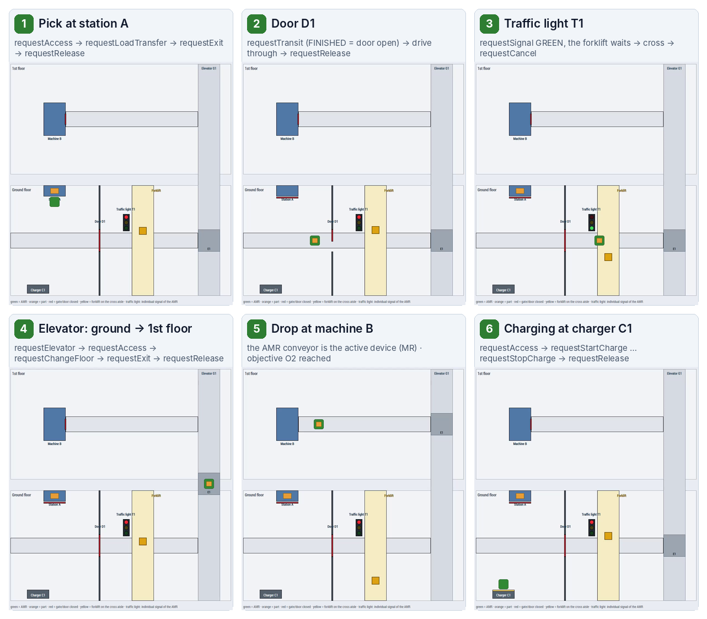
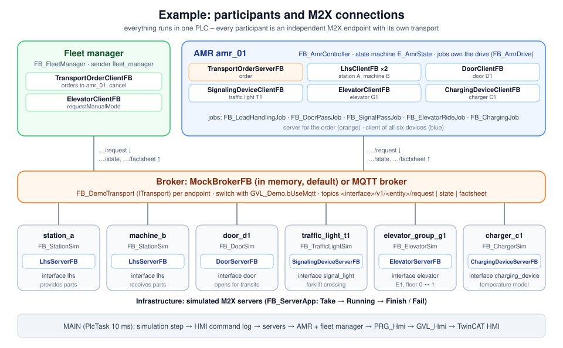
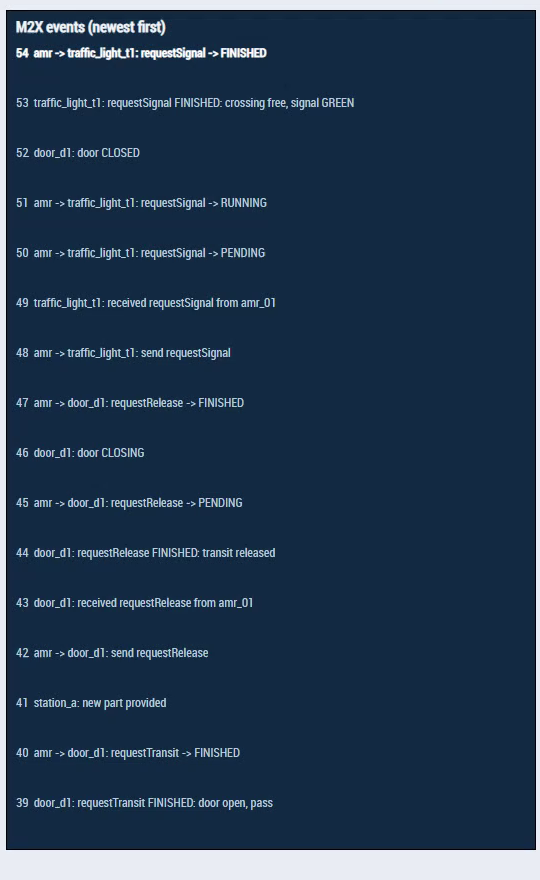

# Example: AMR transport with the complete infrastructure

This page describes the example solution `M2XLibraryExample/M2XLibraryExample.tnzip`. It shows **every M2X interface in one scenario**, in both roles (client and server). Everything runs in one TwinCAT PLC, without network and without extra licenses. A TwinCAT HMI shows live what happens.

What M2X is and which requests exist is explained in [M2X explained](M2X.md). How the function blocks are used in general is described in the [usage guide](Usage.md).

- [1. The scenario](#1-the-scenario)
- [2. Getting started](#2-getting-started)
- [3. Structure of the solution](#3-structure-of-the-solution)
- [4. Participants](#4-participants)
- [5. Sequence of a transport order](#5-sequence-of-a-transport-order)
- [6. The patterns in the code](#6-the-patterns-in-the-code)
- [7. The HMI](#7-the-hmi)
- [8. Test functions](#8-test-functions)
- [9. Configuration](#9-configuration)
- [10. Notes and limitations](#10-notes-and-limitations)

---



## 1. The scenario

A fleet manager sends a transport order to an AMR (autonomous mobile robot): *pick a part at station A on the ground floor and deliver it to machine B on the first floor*. On its way the AMR needs the infrastructure of the building, and it talks to every device using M2X only:

1. **Station A**: the AMR docks, and the station conveyor transfers the part onto the AMR.
2. **Door D1**: the door opens for the AMR and closes again once the AMR has released it.
3. **Traffic light T1**: the AMR crosses an aisle with forklift traffic. It requests its individual signal GREEN, and the forklift waits.
4. **Elevator G1**: the AMR rides from the ground floor to the first floor.
5. **Machine B**: the AMR conveyor pushes the part into the machine. The transport order is finished.
6. **Return trip and charging**: elevator, traffic light and door in the opposite direction, then charging at **charger C1**.



All requests used in the example:

| Interface | Requests in the example | Client | Server |
|---|---|---|---|
| Transport order (`order`) | `requestTransportOrder`, `requestCancel`, `requestFactsheet` | fleet manager | AMR |
| Load handling station (`lhs`) | `requestAccess`, `requestLoadTransfer`, `requestContinueLoadTransfer`, `requestExit`, `requestRelease`, `requestFactsheet` | AMR | station A, machine B |
| Door (`door`) | `requestTransit`, `requestRelease`, `requestFactsheet` | AMR | door D1 |
| Signaling device (`signal_light`) | `requestSignal`, `requestCancel`, `requestFactsheet` | AMR | traffic light T1 |
| Elevator (`elevator`) | `requestElevator`, `requestAccess`, `requestChangeFloor`, `requestExit`, `requestRelease`, `requestFactsheet` | AMR | elevator group G1 |
| Elevator (`elevator`) | `requestManualMode` | fleet manager | elevator group G1 |
| Charging device (`charging_device`) | `requestAccess`, `requestStartCharge`, `requestStopCharge`, `requestRelease`, `requestFactsheet` | AMR | charger C1 |

## 2. Getting started

**Requirements:** TwinCAT 3.1.4024 or newer (XAE Shell or Visual Studio) with the local runtime, and TwinCAT HMI (engineering) for the HMI. The M2X libraries, `M2XLibrarySysDep_Tc` and TcUnit are included in the archive. With the default setting (mock broker) neither a TF6701 license nor an MQTT broker is needed.

1. **Open the archive:** *File → Open → Open Solution from Archive…* → `M2XLibraryExample/M2XLibraryExample.tnzip` → choose a target folder. The solution `Example.sln` contains the PLC project `PlcProject` and the HMI project `M2XDemoHmi`.
2. **Install the libraries** (if TwinCAT asks for them): the archive brings `M2XLibrary`, `M2XLibrarySysDep` and TcUnit in `PlcProject/_Libraries`. Otherwise install them from the repository as described in the [usage guide](Usage.md#2-setup).
3. **Activate the PLC:** choose the local target, *Activate Configuration* (a trial license is fine), then log in and start the PLC.
4. **Start the HMI:** start the HMI live view in the HMI project, or publish it to the local HMI server. The HMI reads the PLC through ADS (local runtime, port 851).
5. Press **New transport order**.

> Always use a **full download** (Activate Configuration / Login with download). An online change moves the transport function blocks in memory, but the mock broker keeps pointers to them. Messages would then be delivered to the old addresses.

## 3. Structure of the solution

```
Example.sln
├─ PlcProject/                    PLC project (PlcTask 10 ms)
│  ├─ MAIN                        calls all participants, HMI command log
│  └─ M2XDemo/
│     ├─ Common/                  shared helpers
│     │  ├─ GVL_Demo              settings, mock broker, event log, entity names, layout
│     │  ├─ GVL_Hmi               HMI commands and display values
│     │  ├─ FB_DemoTransport      ITransport: mock broker or MQTT
│     │  ├─ FB_M2XStep            client side: follows one request
│     │  ├─ FB_ServerApp          server side: Take / Running / Finish / Fail
│     │  ├─ FB_EventLog           event log (16 lines)
│     │  └─ ST_Pose, F_Vis
│     ├─ FleetManager/
│     │  └─ FB_FleetManager       transport order client, elevator client
│     ├─ Amr/
│     │  ├─ FB_AmrController      transport order server + 6 clients, main sequence
│     │  ├─ FB_AmrDrive           simple drive model (1.2 m/s, two floors)
│     │  ├─ FB_LoadHandlingJob    FB_DoorPassJob  FB_SignalPassJob
│     │  ├─ FB_ElevatorRideJob    FB_ChargingJob
│     │  └─ E_AmrState, E_<Job>Step
│     ├─ Infrastructure/          simulated M2X servers
│     │  ├─ FB_StationSim         station A and machine B
│     │  ├─ FB_DoorSim            FB_TrafficLightSim
│     │  └─ FB_ElevatorSim        FB_ChargerSim
│     └─ PRG_Hmi                  positions, texts, visibilities for the HMI
└─ Hmi/                           TwinCAT HMI project M2XDemoHmi (Desktop.view, German / English)
```

The comment block at the top of `MAIN` contains the same overview directly in the code, including where each sequence can be found.

## 4. Participants



Every participant is an **independent M2X endpoint** with its own transport (`FB_DemoTransport`). The endpoints do not call each other directly. They only exchange M2X messages over the broker, exactly as if they were separate devices. That is why the code of a participant can be moved to a real device unchanged, for example the AMR part to the PLC of a real AMR.

| Participant | Function block | Entity | M2X role |
|---|---|---|---|
| Fleet manager | `FB_FleetManager` | sender `fleet_manager` | `TransportOrderClientFB` (to `amr_01`), `ElevatorClientFB` |
| AMR | `FB_AmrController` | `amr_01` | `TransportOrderServerFB`, `LhsClientFB` ×2, `DoorClientFB`, `SignalingDeviceClientFB`, `ElevatorClientFB`, `ChargingDeviceClientFB` |
| Station A | `FB_StationSim` | `station_a`, point `LHP_A1` | `LhsServerFB` (source: provides parts, station conveyor is active) |
| Machine B | `FB_StationSim` | `machine_b`, point `LHP_B1` | `LhsServerFB` (receiver: processes parts for 8 s, AMR conveyor is active) |
| Door D1 | `FB_DoorSim` | `door_d1`, door `D1` | `DoorServerFB` |
| Traffic light T1 | `FB_TrafficLightSim` | `traffic_light_t1` | `SignalingDeviceServerFB` (global signal RED, individual signal GREEN) |
| Elevator group G1 | `FB_ElevatorSim` | `elevator_group_g1`, elevator `E1` | `ElevatorServerFB` (floors `0` and `1`) |
| Charger C1 | `FB_ChargerSim` | `charger_c1` | `ChargingDeviceServerFB` |

**Cycle of `MAIN`** (PlcTask 10 ms):

1. Simulation time step `GVL_Demo.fDt` (cycle time × `fSimSpeed`) for all physical models
2. `HmiCommandLog`: writes every HMI button and switch into the event log
3. Infrastructure (servers)
4. AMR and fleet manager (clients)
5. `PRG_Hmi`: prepares positions, texts and visibilities in `GVL_Hmi`

## 5. Sequence of a transport order

### 5.1 Start-up

After the start the AMR waits until all six devices have published their retained **state** (`StateReceived`). Then it sends `requestFactsheet` to all of them (state `ReadFactsheets`, timeout 5 s). The fleet manager requests the factsheet of the AMR in the same way.

### 5.2 The order

`FB_FleetManager` creates the order `TO-n` with two objectives:

| Objective | Destination | Action | Load handling unit |
|---|---|---|---|
| `O1` | `station_a` | `PICK` | `BOX-n`, `small_load_carrier`, 4.2 kg |
| `O2` | `machine_b` | `DROP` | – |

The order is sent with `SendTransportOrder()` to the AMR. The library of the AMR (`TransportOrderServerFB`) receives it as a **PENDING** request. The AMR accepts it with `SetRequestStatus(RUNNING)`, reports every reached objective with `SetObjectiveReached()` and finishes the order with `SetRequestStatus(FINISHED)`. The fleet manager sees the progress in the state of the AMR (`OrderState.LastObjectiveId`, open objectives).

### 5.3 Main sequence of the AMR

`FB_AmrController` is a step chain over `E_AmrState`:

```
Init → ReadFactsheets → Idle → StartOrder → NextObjective
     → (PassDoor → PassCrossing → RideElevator) → LoadHandling → ObjectiveReached → NextObjective …
     → FinishOrder → (RideElevator → PassCrossing → PassDoor) → Charge → Idle
Error  ← from every state on a failed request (leave with AMR reset)
```

The method `StartTravel(nFloor, eNext)` plans the way to a floor: **upwards** door → crossing → elevator, **downwards** elevator → crossing → door. Each part of the way is a **job FB** with its own step chain. A job is started with `bExecute` and owns the drive while it is active:

| Job | Steps (M2X requests in bold) |
|---|---|
| `FB_LoadHandlingJob` | drive in front of the point → **requestAccess** → drive in → **requestLoadTransfer** → **requestExit** → drive out → **requestRelease** · after a failed transfer: wait for the acknowledgement at the station → **requestContinueLoadTransfer** |
| `FB_DoorPassJob` | drive to the door → **requestTransit** (FINISHED and `DoorStatus = OPEN`) → drive through → **requestRelease** |
| `FB_SignalPassJob` | drive to the stop line → **requestSignal** `GREEN` (FINISHED when the crossing is free) → cross → **requestCancel** |
| `FB_ElevatorRideJob` | **requestElevator** (from floor, target floor) → **requestAccess** → drive into the car → **requestChangeFloor** → **requestExit** → drive out → **requestRelease** · rejected in manual mode, repeated every 3 s |
| `FB_ChargingJob` | drive in front of the charger → **requestAccess** → dock → **requestStartCharge** → charge → **requestStopCharge** → undock → **requestRelease** |

Every session gets its own id (`LS-n` load handling, `ES-n` elevator, `CS-n` charging).

### 5.4 Device side

Each simulation handles the requests of its server in one `CASE` over the request type. It reports **RUNNING** while the physical action is in progress, and **FINISHED** only when the action is really done:

| Device | Behaviour |
|---|---|
| Station A / machine B | `requestAccess` waits until a part is provided (source) or the last part is processed (receiver), then opens the gate · `requestLoadTransfer` runs the conveyor · with *fault machine B* the transfer stops halfway with an error until it is acknowledged |
| Door D1 | opens on `requestTransit`, FINISHED when it is completely open · closes when no robot has an open transit (`OpenTransitCount = 0`) |
| Traffic light T1 | the forklift drives on the cross aisle · `requestSignal` is FINISHED when the forklift is outside the crossing; the forklift then waits until the AMR cancels the signal |
| Elevator G1 | the car moves with 1 m/s, the car door needs 1.5 s · `requestChangeFloor` is FINISHED when the car is at the target floor and the door is open · `requestManualMode` switches between AUTOMATIC and MANUAL |
| Charger C1 | extends the contacts on `requestAccess` and reports the charging process (`CHARGING` / `DONE`) in its state · a simple temperature model is shown in the HMI |

## 6. The patterns in the code

The example uses three small helpers. They are a good starting point for your own applications.

**Server side: `FB_ServerApp`** takes the next request from the server and reports its status:

```iecst
// FB_DoorSim (excerpt)
fbServer(Enable := TRUE, Transport := fbTransport, DoorId := GVL_Demo.DOOR_ID, DoorStatus := eDoorStatus);
fbTransport(bEnable := TRUE, sClientId := GVL_Demo.ENTITY_DOOR);

IF ( fbApp.Take() )                       // GetNextRequest() – one request at a time
THEN
  CASE fbApp.stRequest.RequestType OF
    RequestTypeEnum.REQUEST_TRANSIT:
      fbApp.Running();                      // SetRequestStatus(RUNNING) once
      bOpenCmd := TRUE;
      IF ( eDoorStatus = DoorStatusEnum.OPEN ) THEN fbApp.Finish(sText := 'door open, pass'); END_IF

    RequestTypeEnum.REQUEST_RELEASE:
      fbApp.Finish(sText := 'transit released');
  ELSE
    fbApp.Fail(sText := 'request not handled');
  END_CASE
END_IF
```

**Client side: `FB_M2XStep`** follows one request. It is started with the request id returned by the client method and then called every cycle:

```iecst
// FB_DoorPassJob (excerpt)
E_DoorPassStep.RequestTransit:
  IF ( bEntry )
  THEN
    fbStep.Start(RequestId := Client.RequestDoor(RequestType := RequestTypeEnum.REQUEST_TRANSIT, TargetDoorId := sDoorId),
                 RequestType := RequestTypeEnum.REQUEST_TRANSIT);
  END_IF
  fbStep(Client := Client);
  IF ( fbStep.bDone AND (Client.DoorStatus = DoorStatusEnum.OPEN) )
  THEN
    eStep := E_DoorPassStep.DriveThrough;
  ELSIF ( fbStep.bFailed )
  THEN
    sErrorText := CONCAT('transit failed: ', LEFT(fbStep.sResult, 60));
    eStep := E_DoorPassStep.Error;
  END_IF
```

**Transport: `FB_DemoTransport`** implements `ITransport` and forwards every call either to a `MockTransportFB` (in-memory broker `GVL_Demo.fbBroker`) or to an `MqttTransportFB`. The choice is latched in the first cycle. Call order per endpoint: first the M2X function block, then its transport.

Both helpers write every status change into the event log (`GVL_Demo.fbLog`). That makes the complete message exchange visible in the HMI.

## 7. The HMI

The HMI (`Hmi/Desktop.view`) is a single page at 1920 × 1080. It switches between **German and English** with the buttons **DE / EN** at the top right (TwinCAT HMI localization, `Localization/de.localization` and `en.localization`).

| Area | Content |
|---|---|
| Plan (left) | first floor with machine B, ground floor with station A, door D1, traffic light T1, forklift aisle, charger C1 and the elevator shaft · green = AMR, orange = part, red = gate / door closed, yellow = forklift |
| AMR | state, activity, current objective, order, battery |
| Infrastructure | phase and parts of the stations, door status and open transits, signals of the traffic light, elevator floor and operation mode, charging process and temperature (simulated) |
| Fleet manager | order status, last objective, number of messages on the broker, buttons and switches |
| M2X events (right) | the last 16 events, newest first: sent requests, status changes, received requests, results |



The event log reads like this (newest line on top):

```
54  amr -> traffic_light_t1: requestSignal -> FINISHED
53  traffic_light_t1: requestSignal FINISHED: crossing free, signal GREEN
52  door_d1: door CLOSED
51  amr -> traffic_light_t1: requestSignal -> RUNNING
50  amr -> traffic_light_t1: requestSignal -> PENDING
49  traffic_light_t1: received requestSignal from amr_01
48  amr -> traffic_light_t1: send requestSignal
```

Lines with `amr -> …` come from the client (`FB_M2XStep`, status read from the state of the device), lines with the device name come from the server application (`FB_ServerApp`) or the simulation.

All values come from `GVL_Hmi` and are filled by `PRG_Hmi` (positions at 40 px per metre, texts, visibilities as `'Visible'` / `'Hidden'`). The log lines are mapped as single strings `GVL_Hmi.sLog01 … sLog16`.

## 8. Test functions

| Control | Effect | What it shows |
|---|---|---|
| **New transport order** | sends `TO-n` | complete sequence |
| **Cancel order** | `requestCancel` for the current order | the library marks the order as canceled, the AMR drives back to the charger |
| **Send new orders automatically** | new order 5 s after the previous one | continuous operation · a waiting order stops the charging early (battery ≥ 30 %) |
| **Elevator in manual mode** | `requestManualMode` MANUAL / AUTOMATIC from the fleet manager | `requestElevator` is rejected, the AMR retries every 3 s until the elevator is back in AUTOMATIC |
| **Fault machine B (next transfer)** | the next load transfer at machine B stops halfway | `requestLoadTransfer` FAILED, error in the state of machine B, the AMR waits |
| **Acknowledge fault** | clears the error of machine B | the AMR sends `requestContinueLoadTransfer` and finishes the drop |
| **AMR reset** | leaves the error state of the AMR | recovery after a failed request |

Every press is also written into the event log, including a hint if the command has no effect at the moment (for example *acknowledge fault – no active fault*).

## 9. Configuration

All settings are in `GVL_Demo`:

| Variable | Default | Meaning |
|---|---|---|
| `bUseMqtt` | `FALSE` | `FALSE` = in-memory mock broker, `TRUE` = real MQTT broker (TF6701 license and broker needed) · evaluated in the first cycle only |
| `sMqttHost` / `nMqttPort` | `127.0.0.1` / `1883` | MQTT broker (only with `bUseMqtt`) |
| `fSimSpeed` | `1.0` | simulation speed (2.0 = twice as fast) |
| `ENTITY_…`, `POINT_…`, `DOOR_ID`, `FLOOR_…` | | entity names and ids of the devices |
| `POSE_…` | | layout of the plan in metres |

**With MQTT** every endpoint connects with its own client id (for example `amr_01_door`, `door_d1`). With a broker such as Mosquitto the complete traffic can then be watched from outside:

```bash
mosquitto_sub -h 127.0.0.1 -v -t '#'
```

## 10. Notes and limitations

- The physics (drive, conveyor, door, elevator, battery, temperature) is deliberately simple. The focus is the M2X message exchange.
- Always do a **full download**, not an online change (see [2. Getting started](#2-getting-started)).
- Errors that should stay until an operator acknowledges them are added **without request id** (`AddError(..., RequestId := '')`). Errors bound to a request are removed by the library together with the request after `REQUEST_RETENTION`.
- The PLC texts (event log, states) are in English; the HMI texts switch between German and English.
- M2X is not a safety protocol: in a real installation the safety functions (protective doors, muting, light curtains) stay in the safety controller.
