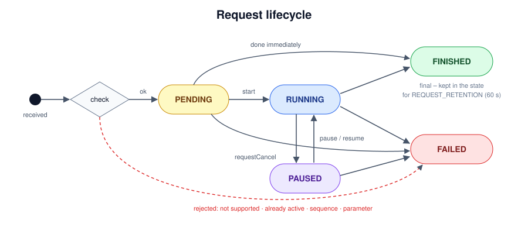
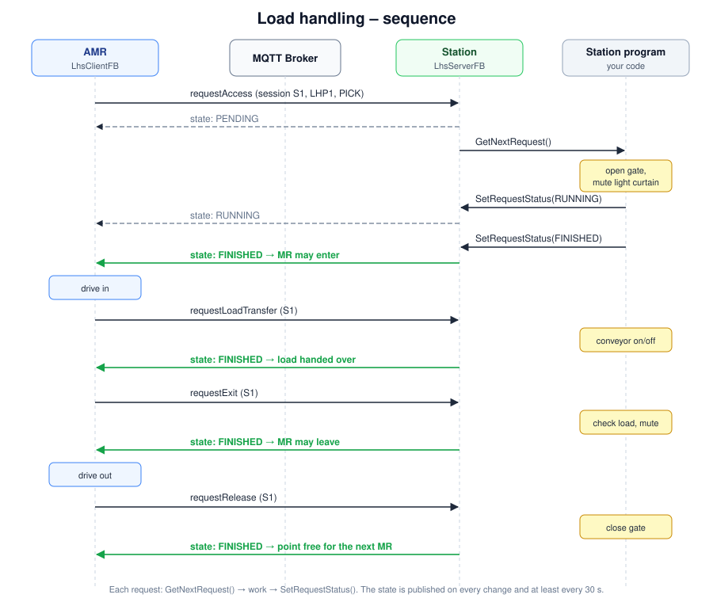
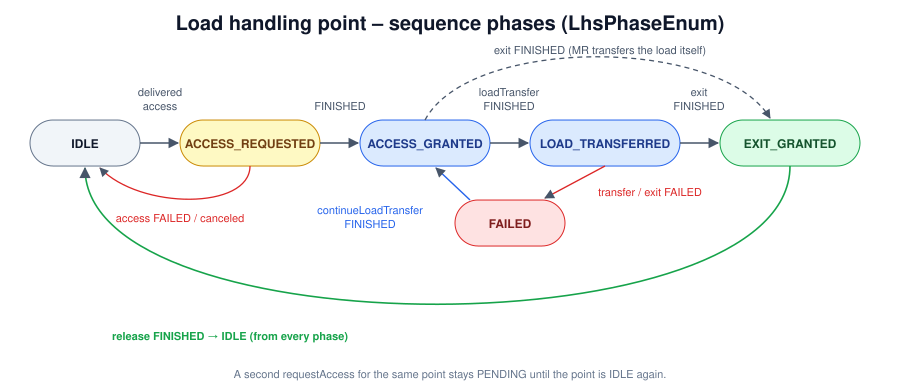

# M2X explained

This page explains what M2X is, how the communication works and which requests ("commands") and state messages ("events") exist. How to use the PLC library is described in the [usage guide](Usage.md).

- [1. What is M2X?](#1-what-is-m2x)
- [2. How it works](#2-how-it-works)
- [3. Messages](#3-messages)
- [4. Request lifecycle](#4-request-lifecycle)
- [5. Interfaces, requests and states](#5-interfaces-requests-and-states)
- [6. Errors](#6-errors)
- [7. Decisions of this library](#7-decisions-of-this-library)

---

## 1. What is M2X?

**M2X ("Machine to X")** is an open interface definition for the communication between **mobile robots** (AMR, AGV) or their **fleet management** and the **environment** of a factory or warehouse: load handling stations, doors, elevators, traffic lights, chargers and the systems that create transport orders.

It is developed by the Chair of Material Handling and Warehousing at TU Dortmund University and Fraunhofer IML, supported by the VDMA and partners from industry. The specification is published at [github.com/M2X-Project/m2x](https://github.com/M2X-Project/m2x) (Apache-2.0). This library implements **M2X 0.9.0 (June 2026)**.

Why M2X? Today every peripheral is usually connected to the fleet management with a project-specific interface. M2X standardises these connections so that a station, a door or an elevator can be used with any fleet management – plug and play. M2X complements **VDA 5050** (fleet management ↔ vehicle), it does not replace it.


## 2. How it works

### Roles

| Role | Who | In this library |
|---|---|---|
| **Server** | the device: station, door, elevator, signaling device, charger; also the receiver of transport orders (fleet management or a vehicle with its own local fleet management) | `…ServerFB` |
| **Client** | whoever wants something from the device: fleet management, AMR/AGV, upper layer system (ERP, WMS, call button) | `…ClientFB` |

A PLC can be both: a self-built AMR is a client towards stations and doors, and a server when it receives transport orders or acts as a load handling station for another robot.

### Transport

M2X is middleware-neutral but assumes **publish/subscribe**. The recommended transport is **MQTT with JSON** (UTF-8). Both sides are MQTT clients of one broker; the PLC is never the broker.

The specification names other protocols such as OPC UA as possible alternatives, but defines no mapping for them. This library implements MQTT; a transport is exchangeable via the interface `ITransport`.

### Topics

Every device (entity) has three topics:

```
<interfaceName>/<version>/<entityName>/request     client → device
<interfaceName>/<version>/<entityName>/state       device → clients (retained)
<interfaceName>/<version>/<entityName>/factsheet   device → clients (retained)
```

| Interface | interfaceName | Example entity |
|---|---|---|
| Load handling station | `lhs` | `lhs/v1/lhs_conveyor_1/state` |
| Transport order | `order` | `order/v1/fm_main/request` |
| Door | `door` | `door/v1/door_hall_2/state` |
| Signaling device | `signal_light` | `signal_light/v1/tl_crossing_3/state` |
| Elevator | `elevator` | `elevator/v1/elv_group_a/state` |
| Charging device | `charging_device` | `charging_device/v1/charger_5/state` |

### The three message types

| Message | Direction | Content |
|---|---|---|
| **Request** | client → device | one or more requests (`requestType`, `requestId`, parameters) |
| **State** | device → clients | device status, status of every request, active errors. Sent on **every change** and **at least every 30 s** |
| **Factsheet** | device → clients | self-description: geometry, capabilities, supported requests. Published once (retained) and on `requestFactsheet` |

### Basic rules

- **Request-response via state:** a request is never answered directly. The client finds the status of its request (`requestId`) in the next state message.
- **One active request per participant:** a client may have only one PENDING / RUNNING / PAUSED request at a device. Exception: a door may stay open for several transits.
- **Cancel** with `requestCancel`.
- **Connection state** `ONLINE`, `OFFLINE` (switched off in an orderly way), `CONNECTION_BROKEN` (unexpected loss, sent by the broker as MQTT last will).
- **The JSON schemas are normative** – if text and schema differ, the schema applies.

## 3. Messages

### Request (example: AMR asks a station for access)

```json
{
  "headerId": 0,
  "timestamp": "2026-10-15T20:12:01.123Z",
  "version": "0.9.0",
  "senderId": "amr_07",
  "requests": [
    {
      "requestType": "requestAccess",
      "requestId": "3f2b8c1e-5d7a-4e21-9c4b-8a1f2e3d4c5b",
      "requestParameters": [
        { "key": "loadHandlingSessionId",    "value": "S-0815" },
        { "key": "loadHandlingPointId",      "value": "LHP1" },
        { "key": "vehicleType",              "value": "AMR" },
        { "key": "loadAction",               "value": "PICK" },
        { "key": "activeLoadTransferDevice", "value": "LHS" }
      ]
    }
  ]
}
```

### State (example: the station works on the request)

```json
{
  "headerId": 12,
  "timestamp": "2026-10-15T20:12:01.480Z",
  "version": "0.9.0",
  "serialNumber": "SN-4711",
  "manufacturer": "ACME",
  "connectionStateLHS": "ONLINE",
  "loadHandlingPointStates": [
    {
      "loadHandlingPointId": "LHP1",
      "operationMode": "AUTOMATIC",
      "connectionStateLHP": "ONLINE",
      "loadHandlingSessionId": "S-0815",
      "requestStates": [
        {
          "requestId": "3f2b8c1e-5d7a-4e21-9c4b-8a1f2e3d4c5b",
          "requestType": "requestAccess",
          "requestStatus": "RUNNING",
          "senderId": "amr_07"
        }
      ],
      "errors": []
    }
  ]
}
```

## 4. Request lifecycle



| Status | Meaning |
|---|---|
| `PENDING` | received and accepted, not yet started (e.g. the point is still occupied by another robot) |
| `RUNNING` | the device executes the request |
| `PAUSED` | interrupted, e.g. light curtain violated – continues automatically |
| `FINISHED` | done successfully – final |
| `FAILED` | could not be done, rejected or canceled – final, usually with an error |

## 5. Interfaces, requests and states

All interfaces additionally know `requestFactsheet` (the device publishes its factsheet) and `requestCancel` (cancels the active request of the sender).

### 5.1 Load handling station (`lhs`)

A station (conveyor, rack, machine, another robot) where a load is picked up (`PICK`) or dropped (`DROP`). A station can have several **load handling points** (LHP); only one robot per point at a time.

| Request | Parameters | FINISHED means |
|---|---|---|
| `requestAccess` | `loadHandlingSessionId`, `loadHandlingPointId`, `vehicleType`, `loadAction` (PICK/DROP), `loadHandlingUnit`, `activeLoadTransferDevice` (MR/LHS) | station is prepared (gate open, muting active) – the robot may enter |
| `requestLoadTransfer` | `loadHandlingSessionId` | the station handed over / took the load, or is ready for the robot to do it |
| `requestExit` | `loadHandlingSessionId` | the robot may leave |
| `requestRelease` | `loadHandlingSessionId` | the robot has left, the point is free again |
| `requestContinueLoadTransfer` | `loadHandlingSessionId` | continue after a failed transfer |



The library keeps a sequence phase per point and rejects requests in the wrong order (`REQUEST_SEQUENCE_ERROR`):



**State (events):** `connectionStateLHS`, and per point `loadHandlingPointId`, `operationMode` (AUTOMATIC/MANUAL/SERVICE), `connectionStateLHP`, `loadHandlingSessionId`, `requestStates[]`, `errors[]`.

### 5.2 Door (`door`)

Door, gate, barrier, hatch. In front of the door is a transition area managed by the door.

| Request | Parameters | FINISHED means |
|---|---|---|
| `requestTransit` | `doorId` | the door is open – the robot may pass |
| `requestRelease` | `doorId` | the robot has passed; the door may close when no transit is open any more |

**State:** `connectionState`, `doorState` with `doorId`, `doorStatus` (OPEN/CLOSED/OPENING/CLOSING), `requestStates[]`, `errors[]`.

### 5.3 Signaling device (`signal_light`)

Traffic light, signal lamp. Shows a **global signal** for everybody and **individual signals** per request.

| Request | Parameters | FINISHED means |
|---|---|---|
| `requestSignal` | `signalId` (must be requestable) | the signal is shown for this robot |
| `requestCancel` | – | the individual signal of the sender is removed |

**State:** `signalingDeviceState` with `signalingDeviceId`, `globalSignal`, `individualSignals[]`, `plannedSignals[]`, `requestStates[]` (with `requestedSignal`), `errors[]`.

### 5.4 Elevator (`elevator`)

An elevator or a group of elevators. `requestElevator` assigns an elevator of the group to a session.

| Request | Parameters | FINISHED means |
|---|---|---|
| `requestElevator` | `elevatorSessionId`, `requestedFloor`, `intendedTargetFloor`, `vehicleType` | an elevator is assigned and waits on `requestedFloor` |
| `requestAccess` | `elevatorSessionId` | doors open – the robot may enter |
| `requestChangeFloor` | `elevatorSessionId`, `targetFloor` | the target floor is reached |
| `requestExit` | `elevatorSessionId` | doors open – the robot may leave |
| `requestRelease` | `elevatorSessionId` | the robot has left, the elevator is free |
| `requestManualMode` | `operationMode` | the elevator is in manual mode |

**State:** `groupId`, per elevator `elevatorId`, `connectionState`, `operationMode`, `currentFloor` (name, level), `requestStates[]`, `assignedElevators[]`, `errors[]`.

### 5.5 Charging device (`charging_device`)

| Request | Parameters | FINISHED means |
|---|---|---|
| `requestAccess` | `chargingSessionId` | the robot may dock |
| `requestStartCharge` | `chargingSessionId` | charging has started |
| `requestStopCharge` | `chargingSessionId` | charging has stopped |
| `requestRelease` | `chargingSessionId` | the robot has left, the charger is free |

**State:** `chargingDeviceState` with `chargingDeviceId`, `currentCharging` (session), `requestStates[]` with `chargingProcess` (CHARGING/DONE/IDLE, temperature, charging rate, derating), `operatingHours`, `errors[]`.

### 5.6 Transport order (`order`)

The upper layer system (ERP, WMS, a call button) sends a transport order to the fleet management or to a robot with local fleet management. An order is a list of **objectives** – WHAT (`PICK`, `DROP`, `VIA`) and WHERE (`destination`).

| Request | Parameters | FINISHED means |
|---|---|---|
| `requestTransportOrder` | `transportOrderId`, `transportOrderUpdateId`, `isObjectiveListComplete`, `resourceId`, `priority`, `objectives[]` | new order: completely executed. Update (same id, higher update id): accepted |
| `requestCancel` | `transportOrderId`, `isCanceled` | the order is canceled |

**State:** `transportOrderId`, `transportOrderUpdateId`, `lastObjectiveId`, `isCanceled`, `objectiveStates[]` (open objectives), `requestStates[]`, `errors[]`.

## 6. Errors

An error is reported in the `errors[]` array of the state as long as it is active.

| Field | Meaning |
|---|---|
| `errorType` | type, see below |
| `errorLevel` | `WARNING` (resolves itself) or `FATAL` (needs a human) |
| `errorDescription` | text |
| `requestId` | request that caused the error (optional) |
| `errorReferences[]` | key/value references, e.g. `objectiveId` (optional) |

| errorType | Source | Meaning |
|---|---|---|
| `ERROR_DURING_EXECUTION` | M2X | execution failed (device, robot or external reason) |
| `ERROR_IN_VALIDATION` | M2X | inconsistent transport order data, e.g. update id not increasing |
| `OBJECTIVE_ALREADY_FINISHED` | M2X | an update tries to change an objective that is already done |
| `OBJECTIVE_IN_EXECUTION` | M2X | the objective is already being executed |
| `SEQUENCE_ID_NON_CONTIGUOUS` | M2X | gap in the `sequenceId` of an update |
| `REQUEST_NOT_SUPPORTED` | library | the device does not support this request type |
| `REQUEST_ALREADY_ACTIVE` | library | the sender already has an active request |
| `INVALID_REQUEST_PARAMETER` | library | parameter missing or invalid (unknown point, signal not requestable …) |
| `REQUEST_SEQUENCE_ERROR` | library | request not allowed in the current phase (e.g. `requestLoadTransfer` without access) |
| `INVALID_MESSAGE` | library | the request message could not be parsed |
| `REQUEST_TABLE_FULL` | library | no free entry in the request table |

## 7. Decisions of this library

M2X 0.9.0 leaves some points open (see the [GitHub issues](https://github.com/M2X-Project/m2x/issues)). This library decides them as follows; the behaviour is compatible with the schemas, additional fields are optional.

| Topic | Decision |
|---|---|
| Request topic | one generic topic `…/request` per entity (issue #19); `requestFactsheet` is a request type on this topic |
| Version in the topic | `v1` (configurable via `EndpointConfigData.TopicVersion`) |
| `headerId` | sent in every request, state and factsheet, counted per topic |
| Request parameters | one `{key, value}` per parameter; the nested format of the example schemas (`{key: "requestAccess", value: {…}}`) is accepted as well |
| Sender identity | optional top-level `senderId` in the request, echoed in `requestStates[]`; used to enforce "one active request per participant" |
| Error object | one common object for all interfaces (`errorType`, `errorLevel`, `errorDescription`, `requestId`, `errorReferences[]`) |
| Connection state | MQTT last will with `CONNECTION_BROKEN` on the state topic, `OFFLINE` is published when the server is disabled |
| MQTT | QoS 1, state and factsheet retained |
| Final requests | stay in the state for 60 s (`REQUEST_RETENTION`), then they and their errors are removed |
