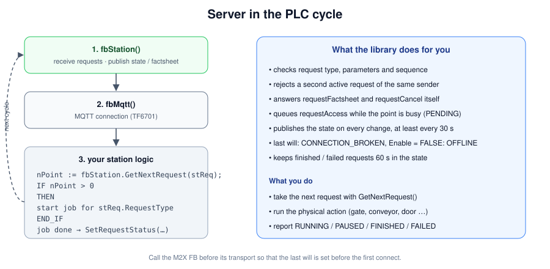

# Usage guide

How to use the M2X PLC library in TwinCAT 3 and CODESYS. The program examples are the same for both targets; the differences are listed in [1. Requirements](#1-requirements) and [2. Setup](#2-setup). What M2X is and which requests and states exist is explained in [M2X explained](M2X.md).

- [1. Requirements](#1-requirements)
- [2. Setup](#2-setup)
- [3. Basic concept](#3-basic-concept)
- [4. Server example: load handling station](#4-server-example-load-handling-station)
- [5. Client example: AMR at a station](#5-client-example-amr-at-a-station)
- [6. The other interfaces](#6-the-other-interfaces)
- [7. Configuration](#7-configuration)
- [8. Errors and diagnosis](#8-errors-and-diagnosis)
- [9. Tests](#9-tests)
- [10. Troubleshooting](#10-troubleshooting)

---

## 1. Requirements

| What | TwinCAT | CODESYS |
|---|---|---|
| PLC | TwinCAT 3.1.4024 or newer, XAE Shell or Visual Studio (tested with 3.1.4026.19) | CODESYS 3.5 SP20 (tested with ctrlX PLC Engineering 3.6) |
| MQTT client | TF6701 IoT Communication (`Tc3_IotBase`); a 7-day trial license works for testing | CODESYS IIoT Libraries SL (MQTT Client SL) – not bound yet, see below |
| MQTT broker | e.g. [Mosquitto](https://mosquitto.org) – reachable from the PLC | e.g. [Mosquitto](https://mosquitto.org) – reachable from the PLC |
| Tests | TcUnit 1.3 | – (test project only for TwinCAT so far) |

## 2. Setup

The library consists of two parts: the portable main library and one system dependent library per target. Both system dependent libraries have the same title **`M2XLibrarySysDep`**, so the main library works with whichever one is installed.

| Library | File | Content |
|---|---|---|
| `M2XLibrary` | `M2XLibrary.library` (PLCopen: `M2XLibrary.xml`) | all servers, clients, JSON, transports |
| `M2XLibrarySysDep` for TwinCAT | `M2XLibrarySysDep_Tc.library` | MQTT (`Tc3_IotBase`), time, memory, LREAL check |
| `M2XLibrarySysDep` for CODESYS | `M2XLibrarySysDep_3S.library` | time (`SysTimeRtc`), memory (`SysMem`), LREAL check – MQTT client still open |

**TwinCAT**

1. Install `M2XLibrarySysDep_Tc.library` and then `M2XLibrary.library` (PLC project → References → Library repository → Install).
2. Add the reference **`M2XLibrary`** to your PLC project. `M2XLibrarySysDep` and `Tc3_IotBase` are pulled in as its references.

**CODESYS**

1. Install `M2XLibrarySysDep_3S.library` (Tools → Library Repository → Install).
2. Import `M2XLibrary.xml` (PLCopen XML) into a CODESYS library project and save it as library, or use it directly in your project.
3. Until the MQTT client is bound in `M2XLibrarySysDep_3S`, `MqttTransportFB` reports `Error` with `ErrorId 16#FFFF`; the mock transport and all other functions are usable. The main library has not been tested on CODESYS yet.

The tests (`M2XLibraryTest`) are a separate PLC project with TcUnit, so far only for TwinCAT, see [9. Tests](#9-tests).


## 3. Basic concept

- **One endpoint = one M2X FB + one transport.** A station has one `LhsServerFB` and one `MqttTransportFB`. An AMR that talks to a station and a door has an `LhsClientFB` and a `DoorClientFB`, each with its own `MqttTransportFB`.
- **Call order in every cycle:** first the M2X FB, then its transport. That way the last will is set before the first connect.
- **Requests are taken, not pushed.** A server collects requests; your program takes the next one with `GetNextRequest()` and reports the result with `SetRequestStatus()`.
- **Clients send with a method and poll the status.** `RequestAccess()` & co. return the request id; `GetRequestStatus(id)` shows PENDING → RUNNING → FINISHED / FAILED. Alternatively use `RequestFB` with Execute / Busy / Done / Error.
- **Everything is cyclic and non-blocking.** No method waits; parsing and sending happen within the cycle. Put the M2X code into its own task (e.g. 10 ms) if the machine task is fast.



## 4. Server example: load handling station

A conveyor with one load handling point. The station opens a gate for the access and runs the conveyor for the load transfer.

```iecst
PROGRAM StationPrg
VAR
  /// MQTT connection of the station
  fbMqtt     : MqttTransportFB;
  /// M2X load handling station
  fbStation  : LhsServerFB;
  /// Request that is currently processed
  stRequest  : RequestData;
  /// Empty request (to clear stRequest)
  stNoRequest : RequestData;
  /// A request is being processed
  bBusy      : BOOL;
  /// Initialization done
  bInit      : BOOL;
  /// Gate open (input)
  bGateOpen  : BOOL;
  /// Open the gate (output)
  bOpenGate  : BOOL;
  /// Conveyor finished the transfer (input)
  bTransferDone : BOOL;
  /// Run the conveyor (output)
  bConveyorOn   : BOOL;
END_VAR
```

```iecst
// ---- configuration (once) ----
IF NOT bInit
THEN
  fbMqtt.Config.HostName := '192.168.1.10';
  fbMqtt.Config.Port     := 1883;
  fbMqtt.Config.ClientId := 'lhs_conveyor_1';

  fbStation.Config.EntityName   := 'lhs_conveyor_1';
  fbStation.Config.SerialNumber := 'SN-4711';
  fbStation.Config.Manufacturer := 'ACME';
  fbStation.PointCount                    := 1;
  fbStation.Points[1].LoadHandlingPointId := 'LHP1';
  bInit := TRUE;
END_IF

// ---- 1. M2X server, 2. transport ----
fbStation(Enable := TRUE, Transport := fbMqtt);
fbMqtt(Enable := TRUE);

// ---- 3. station logic ----
IF NOT bBusy
THEN
  bBusy := ( fbStation.GetNextRequest(Request := stRequest) > 0 );
  IF bBusy
  THEN
    fbStation.SetRequestStatus(RequestId := stRequest.RequestId, Status := RequestStatusEnum.RUNNING, ResultDescription := '');
  END_IF
END_IF

IF bBusy
THEN
  CASE stRequest.RequestType OF
    RequestTypeEnum.REQUEST_ACCESS,
    RequestTypeEnum.REQUEST_EXIT:
      // open the gate, then the robot may drive in or out
      bOpenGate := TRUE;
      IF bGateOpen
      THEN
        fbStation.SetRequestStatus(RequestId := stRequest.RequestId, Status := RequestStatusEnum.FINISHED, ResultDescription := '');
        bBusy := FALSE;
      END_IF

    RequestTypeEnum.REQUEST_LOAD_TRANSFER,
    RequestTypeEnum.REQUEST_CONTINUE_LOAD_TRANSFER:
      // stRequest.Parameters.LoadAction tells PICK or DROP (from the access)
      bConveyorOn := TRUE;
      IF bTransferDone
      THEN
        bConveyorOn := FALSE;
        fbStation.SetRequestStatus(RequestId := stRequest.RequestId, Status := RequestStatusEnum.FINISHED, ResultDescription := '');
        bBusy := FALSE;
      END_IF

    RequestTypeEnum.REQUEST_RELEASE:
      bOpenGate := FALSE;
      fbStation.SetRequestStatus(RequestId := stRequest.RequestId, Status := RequestStatusEnum.FINISHED, ResultDescription := '');
      bBusy := FALSE;
  ELSE
    fbStation.SetRequestStatus(RequestId := stRequest.RequestId, Status := RequestStatusEnum.FAILED, ResultDescription := 'not handled');
    bBusy := FALSE;
  END_CASE

  IF NOT bBusy
  THEN
    stRequest := stNoRequest;
  END_IF
END_IF
```

What the library already does for you: it checks the order of the requests (`requestLoadTransfer` without access is rejected), lets a second robot wait in `PENDING` until the point is released, answers `requestFactsheet` and `requestCancel`, and publishes the state.

Useful members of `LhsServerFB`:

| Member | Purpose |
|---|---|
| `Points[i].OperationMode` | AUTOMATIC / MANUAL / SERVICE – in MANUAL or SERVICE `requestAccess` is rejected |
| `Points[i].Online` | FALSE → the point reports `CONNECTION_BROKEN` |
| `GetPhase(PointIndex)` | sequence phase of the point (`LhsPhaseEnum`) |
| `GetSessionId(PointIndex)` | current `loadHandlingSessionId` |
| `GetRequestStatus(RequestId)` | status of a request |
| `AddError(…)` / `RemoveError(ErrorType)` / `ClearErrors()` | errors in the state |
| `SetFactsheet(pData, Length)` | publish your own factsheet JSON (see 7.4) |
| `Connected`, `RequestCount`, `StatesPublished`, `InvalidMessages` | diagnosis outputs |

## 5. Client example: AMR at a station

The vehicle picks up a load at the station from chapter 4.


```iecst
PROGRAM AmrStationPrg
VAR
  /// MQTT connection to the station
  fbMqtt    : MqttTransportFB;
  /// M2X client of the station
  fbStation : LhsClientFB;
  /// Id of the current request
  sRequestId : STRING(64);
  /// Session of this load handling
  sSession   : STRING(64) := 'S-0815';
  /// Step of the sequence
  nStep      : INT;
  /// Initialization done
  bInit      : BOOL;
  /// Start the load handling (input from the vehicle program)
  bStart     : BOOL;
  /// Vehicle reached the load handling point
  bInPosition : BOOL;
  /// Vehicle left the station
  bOutside    : BOOL;
END_VAR
```

```iecst
IF NOT bInit
THEN
  fbMqtt.Config.HostName := '192.168.1.10';
  fbMqtt.Config.ClientId := 'amr_07_lhs';
  // EntityName = name of the TARGET station
  fbStation.Config.EntityName := 'lhs_conveyor_1';
  // own identity, used by the station for "one active request per participant"
  fbStation.SenderId := 'amr_07';
  bInit := TRUE;
END_IF

fbStation(Enable := TRUE, Transport := fbMqtt);
fbMqtt(Enable := TRUE);

CASE nStep OF
  0:
    IF bStart AND fbStation.StateReceived AND ( fbStation.RemoteConnectionState = ConnectionStateEnum.ONLINE )
    THEN
      sRequestId := fbStation.RequestAccess(LoadHandlingSessionId    := sSession,
                                            LoadHandlingPointId      := 'LHP1',
                                            VehicleType              := 'AMR',
                                            LoadAction               := LoadActionEnum.PICK,
                                            ActiveLoadTransferDevice := LoadTransferDeviceEnum.LHS);
      IF sRequestId <> ''
      THEN
        nStep := 10;
      END_IF
    END_IF

  10:
    // wait for access, then drive in
    CASE fbStation.GetRequestStatus(RequestId := sRequestId) OF
      RequestStatusEnum.FINISHED:
        nStep := 20;
      RequestStatusEnum.FAILED:
        nStep := 900;
    END_CASE

  20:
    IF bInPosition
    THEN
      sRequestId := fbStation.RequestSessionStep(RequestType           := RequestTypeEnum.REQUEST_LOAD_TRANSFER,
                                                 LoadHandlingSessionId := sSession,
                                                 LoadHandlingPointId   := '');
      nStep := 30;
    END_IF

  30:
    CASE fbStation.GetRequestStatus(RequestId := sRequestId) OF
      RequestStatusEnum.FINISHED:
        sRequestId := fbStation.RequestSessionStep(RequestType           := RequestTypeEnum.REQUEST_EXIT,
                                                   LoadHandlingSessionId := sSession,
                                                   LoadHandlingPointId   := '');
        nStep := 40;
      RequestStatusEnum.FAILED:
        nStep := 900;
    END_CASE

  40:
    // exit granted → drive out
    IF fbStation.GetRequestStatus(RequestId := sRequestId) = RequestStatusEnum.FINISHED
    THEN
      nStep := 50;
    END_IF

  50:
    IF bOutside
    THEN
      sRequestId := fbStation.RequestSessionStep(RequestType           := RequestTypeEnum.REQUEST_RELEASE,
                                                 LoadHandlingSessionId := sSession,
                                                 LoadHandlingPointId   := '');
      nStep := 60;
    END_IF

  60:
    IF fbStation.GetRequestStatus(RequestId := sRequestId) = RequestStatusEnum.FINISHED
    THEN
      nStep := 0;
    END_IF

  900:
    // error: see fbStation.ErrorCount / GetError(); continue with
    // REQUEST_CONTINUE_LOAD_TRANSFER or end with REQUEST_RELEASE
    ;
END_CASE
```

### RequestFB – PLCopen style

For single requests `RequestFB` is often simpler:

```iecst
VAR
  /// Request block for the factsheet
  fbFactsheet : RequestFB;
  /// Parameters (empty for requestFactsheet)
  stParams    : RequestParameterData;
END_VAR

fbFactsheet(Execute     := bReadFactsheet,
            RequestType := RequestTypeEnum.REQUEST_FACTSHEET,
            Timeout     := T#10S,
            Client      := fbStation,
            Parameters  := stParams);
// fbFactsheet.Busy / Done / Error / ErrorText (SEND_FAILED, REQUEST_FAILED, TIMEOUT) / Status
```

Useful members of every client (`ClientBaseFB`):

| Member | Purpose |
|---|---|
| `StateReceived`, `StateCount` | at least one / number of state messages |
| `RemoteConnectionState` | ONLINE / OFFLINE / CONNECTION_BROKEN of the device |
| `GetRequestStatus(RequestId)`, `GetResultDescription(RequestId)` | status of an own request |
| `ErrorCount`, `GetError(Index, Error)`, `HasError(ErrorType, RequestId)` | errors of the last state |
| `FactsheetReceived`, `FactsheetLength`, `CopyFactsheet(pDest, DestSize)` | factsheet as JSON |
| `SendRequest(RequestType, Description, Parameters)` | any request with your own parameters |
| `ForgetRequest(RequestId)` | stop tracking a request |

## 6. The other interfaces

All servers work like the station: `GetNextRequest()` → act → `SetRequestStatus()`. The table shows what is special.

| Interface | Server inputs | Client methods / outputs |
|---|---|---|
| Door | `DoorId`, `DoorStatus` (from your sensors); `OpenTransitCount` = transits without release – close the door at 0 | `RequestDoor(RequestType, TargetDoorId)`; `DoorStatus` |
| Signaling device | `SignalingDeviceId`, `SignalCount`, `Signals[]` (`SignalId`, `IsRequestable`, `Descriptor`), `GlobalSignalId`; `GetActiveSignal(Index, RequestId, SignalId)` to drive the lamps | `RequestSignal(SignalId)`, `RequestCancel()`; `GlobalSignalId`, `GetIndividualSignal(RequestId)` |
| Charging device | `ChargingDeviceId`, `ChargingProcess` (CHARGING/DONE/IDLE, temperature, rate, derating), `OperatingHours`; `Phase`, `SessionId` | `RequestCharging(RequestType, ChargingSessionId)`; `ChargingProcess`, `CurrentChargingSessionId` |
| Elevator | `GroupId`, `ElevatorCount`, `Elevators[]`, `ElevatorInputs[]` (current floor, operation mode, online). `GetNextRequest()` returns the **elevator index** | `RequestElevator(…)`, `GetAssignedElevator(RequestId)`, `RequestSessionStep(RequestType, ElevatorSessionId, TargetFloor)`, `RequestManualMode(OperationMode)`; `Elevators[]` |
| Transport order | `GetTransportOrder(Order)`, `SetObjectiveReached(ObjectiveId)`, `OrderRequestId`, `IsCanceled`. Updates are accepted by the library itself | `SendTransportOrder(Order)`, `CancelTransportOrder(TransportOrderId)`; `OrderState` |

### Door – server

```iecst
fbDoor.DoorId     := 'D1';
fbDoor.DoorStatus := eDoorStatus;          // from the door control
fbDoor(Enable := TRUE, Transport := fbMqtt);
fbMqtt(Enable := TRUE);

IF fbDoor.GetNextRequest(Request := stRequest) > 0
THEN
  bOpenDoor := ( stRequest.RequestType = RequestTypeEnum.REQUEST_TRANSIT );
  sOpenRequest := stRequest.RequestId;
END_IF
// transit is FINISHED when the door is open
IF ( sOpenRequest <> '' ) AND ( eDoorStatus = DoorStatusEnum.OPEN )
THEN
  fbDoor.SetRequestStatus(RequestId := sOpenRequest, Status := RequestStatusEnum.FINISHED, ResultDescription := '');
  sOpenRequest := '';
END_IF
// close only when every robot has released the door
bCloseDoor := ( fbDoor.OpenTransitCount = 0 );
```

Release requests (`REQUEST_RELEASE`) also come through `GetNextRequest()` and only need `SetRequestStatus(FINISHED)`.

### Transport order – sending from a PLC (call button)

```iecst
stOrder.TransportOrderId       := 'TO-2026-0001';
stOrder.TransportOrderUpdateId := 0;
stOrder.IsObjectiveListComplete := TRUE;
stOrder.Priority               := PriorityEnum.HIGH;
stOrder.ObjectiveCount         := 2;
stOrder.Objectives[1].ObjectiveId     := 'O1';
stOrder.Objectives[1].SequenceId      := 0;
stOrder.Objectives[1].Destination     := 'LHS_CONVEYOR_1';
stOrder.Objectives[1].ObjectiveAction := ObjectiveActionEnum.PICK;
stOrder.Objectives[1].LoadHandlingUnitValid                 := TRUE;
stOrder.Objectives[1].LoadHandlingUnit.LoadHandlingUnitType := 'euro_pallet';
stOrder.Objectives[2].ObjectiveId     := 'O2';
stOrder.Objectives[2].SequenceId      := 1;
stOrder.Objectives[2].Destination     := 'STORAGE_5';
stOrder.Objectives[2].ObjectiveAction := ObjectiveActionEnum.DROP;

sOrderRequest := fbOrder.SendTransportOrder(Order := stOrder);
// progress: fbOrder.OrderState.LastObjectiveId, fbOrder.GetRequestStatus(sOrderRequest)
```

An **update** is the same order with the same `TransportOrderId` and `TransportOrderUpdateId + 1`; objectives from the first `SequenceId` of the update are replaced.

## 7. Configuration

### 7.1 EndpointConfigData (input `Config` of every server and client)

| Field | Default | Meaning |
|---|---|---|
| `InterfaceName` | set by the FB (`lhs`, `door` …) | first topic segment |
| `TopicVersion` | `v1` | second topic segment |
| `EntityName` | – | server: own name; client: name of the target device |
| `SerialNumber`, `Manufacturer` | – | written into state and factsheet (server) |
| `ProtocolVersion` | `0.9.0` | `version` field of the messages |

### 7.2 SysDepMqttConfig (input `Config` of `MqttTransportFB`)

| Field | Default | Meaning |
|---|---|---|
| `HostName`, `Port` | `127.0.0.1`, `1883` | broker |
| `ClientId` | – | must be unique per connection at the broker |
| `UserName`, `Password` | – | optional |
| `KeepAlive` | 60 | seconds |
| `TlsEnabled`, `TlsCaFile`, `TlsCertFile`, `TlsKeyFile`, `TlsKeyPassword`, `TlsNoServerCertCheck` | – | TLS (port usually 8883) |

`MqttTransportFB.QoS` is `AT_LEAST_ONCE` by default. Outputs `Error` and `ErrorId` show problems of the MQTT client.

### 7.3 Library parameters (`M2XLibraryParameter`)

| Parameter | Default | Meaning |
|---|---|---|
| `MESSAGE_SIZE_MAX` | 8192 | max. size of one message in bytes |
| `MESSAGE_QUEUE_MAX` | 8 | received messages per transport and cycle |
| `JSON_TOKEN_MAX` | 512 | max. JSON tokens per message |
| `REQUEST_ENTRIES_MAX` | 16 | request table of a server |
| `ERRORS_MAX` | 8 | active errors per endpoint |
| `POINTS_MAX` | 4 | load handling points / elevators per server |
| `SIGNALS_MAX` | 8 | signals of a signaling device |
| `OBJECTIVES_MAX` | 16 | objectives of a transport order |
| `CLIENT_REQUESTS_MAX` | 16 | requests tracked by a client |
| `STATE_INTERVAL` | T#30S | cyclic state |
| `REQUEST_RETENTION` | T#60S | finished / failed requests stay in the state |

The memory need grows with `MESSAGE_SIZE_MAX` (every server and client holds several message buffers).

### 7.4 Factsheet

The library publishes a minimal factsheet (`headerId`, `timestamp`, `version`, `manufacturer`, `serialNumber`). The full factsheet with geometry and capabilities (see the M2X factsheet schemas) is passed as JSON:

```iecst
fbStation.SetFactsheet(pData := ADR(sFactsheetJson), Length := INT_TO_UDINT(LEN(sFactsheetJson)));
```

For factsheets longer than 255 characters use a byte array (e.g. read from a file) and pass its length – `STRING` functions only work up to 255 characters.

## 8. Errors and diagnosis

**Report errors as a server:**

```iecst
fbStation.AddError(ErrorType        := M2XLibraryConstants.ERR_DURING_EXECUTION,
                   ErrorLevel       := ErrorLevelEnum.FATAL,
                   ErrorDescription := 'light curtain violated',
                   RequestId        := stRequest.RequestId,
                   PointIndex       := 1);
// later
fbStation.RemoveError(ErrorType := M2XLibraryConstants.ERR_DURING_EXECUTION);
```

**Read errors as a client:** `ErrorCount`, `GetError(Index, Error)`, `HasError(ErrorType, RequestId)`.

**Watch the traffic** with the Mosquitto command line tools:

```bash
mosquitto_sub -h 192.168.1.10 -v -t 'lhs/#'
```

## 9. Tests

The test project `M2XLibraryTest` contains 43 TcUnit tests (folder `M2XTest`), called in `MAIN`:

| Suite | Tests | What is tested |
|---|---|---|
| `JsonTestFB` | 13 | JSON writer/parser, escaping, topics, UUID, timestamp, enums, parameter round trip |
| `MockTransportTestFB` | 5 | mock broker: subscribe, wildcards, retained, last will, queue overflow |
| `LhsTestFB` | 9 | full sequence, sequence errors, second robot waits, one active request per sender, cancel, continue after failure, connection loss |
| `DoorTestFB` | 3 | two robots, release, wrong door id |
| `SignalingDeviceTestFB` | 3 | individual signals, not requestable, cancel |
| `ChargingDeviceTestFB` | 2 | charging sequence, sequence error |
| `ElevatorTestFB` | 3 | group state, two robots get two elevators, missing target floor |
| `TransportOrderTestFB` | 4 | new order, update, stale update, cancel |
| `MqttLoopbackTestFB` | 1 | station and AMR over a real MQTT broker |

All tests except the MQTT loopback use the **mock broker** and run without network. The MQTT test is configured in `M2XTestParameter` (`MQTT_TEST_ENABLED`, `MQTT_HOST`, `MQTT_PORT`, `MQTT_TIMEOUT`).

Run (TwinCAT): activate the configuration on the local runtime, the results appear in the error list / TcUnit log. `MAIN.AllFinished` becomes `TRUE` when all suites are done (readable via ADS). A test project for CODESYS does not exist yet.

## 10. Troubleshooting

| Symptom | Cause / solution |
|---|---|
| PLC exception (page fault) | TwinCAT: switch the runtime to **Config mode first**, then activate / Run again · CODESYS: reset the application (warm / cold), then start again |
| License error of the MQTT client | TwinCAT: TF6701 license missing (`License invalid` / `Keine Lizenz vorhanden`) – activate a (trial) license · CODESYS: license of the IIoT Libraries missing (once the MQTT client is bound) |
| Client never gets `StateReceived` | `EntityName` of the client ≠ entity of the server, different `TopicVersion`, broker not reachable (`fbMqtt.Error`, `ErrorId`) |
| Request immediately `FAILED`, error `REQUEST_ALREADY_ACTIVE` | the same `SenderId` already has an active request at this device – wait or cancel |
| Request `FAILED`, `REQUEST_SEQUENCE_ERROR` | wrong order (e.g. `requestLoadTransfer` before access is FINISHED) or wrong session id |
| Request stays `PENDING` | the point / elevator is occupied by another robot, or the server program does not call `GetNextRequest()` |
| Device shows `CONNECTION_BROKEN` | the server lost the broker connection; it reports `ONLINE` again after reconnect |
| `InvalidMessages` counts up | message not valid JSON or larger than `MESSAGE_SIZE_MAX` |
